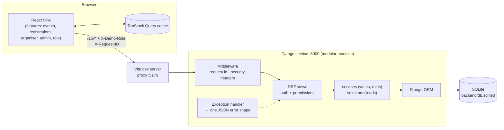
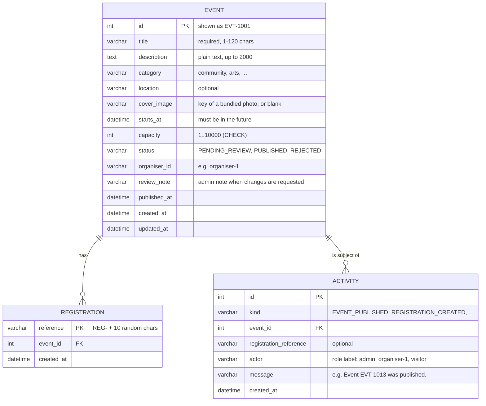

# Gather: Community Events Platform

Visitors browse community events and register interest anonymously. Organisers create and manage their events. Administrators review new events and publish them.

This is a single **Django + Django REST Framework** service (a modular monolith) with a **React + TypeScript** frontend, backed by **SQLite**.

| | |
| --- | --- |
| **Frontend** | http://localhost:5173 |
| **API** | http://localhost:8000/api/v1/ |
| **API docs (Swagger UI)** | http://localhost:8000/api/docs/ |
| **Tests** | 135 backend tests (`pytest`), including a real multi-threaded race for the last spot |
| **Deep dive** | [`docs/ARCHITECTURE.md`](docs/ARCHITECTURE.md): request lifecycle, sequence diagrams, error catalogue, ADRs |

---

## Contents

1. [Quick start](#1-quick-start)
2. [Technology choices](#2-technology-choices)
3. [Architecture](#3-architecture)
4. [Data model and persistence](#4-data-model-and-persistence)
5. [API overview](#5-api-overview)
6. [Testing](#6-testing)
7. [Demonstration guide (brief §7)](#7-demonstration-guide-brief-7)
8. [Security and privacy](#8-security-and-privacy)
9. [Assumptions, trade-offs and future work](#9-assumptions-trade-offs-and-future-work)
10. [AI-use declaration](#10-ai-use-declaration)

---

## 1. Quick start

### Prerequisites

| Tool | Version | Check with |
| --- | --- | --- |
| Python | **3.12+** (developed on 3.12.10) | `python --version` |
| Node.js | **20.19+ or 22.12+** (developed on 24.14) | `node --version` |
| npm | 10+ (developed on 11.11) | `npm --version` |

No database server, Docker or API keys are needed.

### 1.1 Backend (terminal 1)

**Windows (PowerShell)**

```powershell
cd backend
py -3.12 -m venv .venv
.venv\Scripts\Activate.ps1
pip install -r requirements-dev.txt
Copy-Item .env.example .env
python manage.py migrate
python manage.py seed_demo_data
python manage.py runserver 8000
```

**macOS / Linux**

```bash
cd backend
python3.12 -m venv .venv
source .venv/bin/activate
pip install -r requirements-dev.txt
cp .env.example .env
python manage.py migrate
python manage.py seed_demo_data
python manage.py runserver 8000
```

> If PowerShell blocks `Activate.ps1`, run `Set-ExecutionPolicy -Scope Process RemoteSigned` first, or skip activation and call `.venv\Scripts\python` directly.

### 1.2 Frontend (terminal 2)

```bash
cd frontend
npm ci
npm run dev
```

Open **http://localhost:5173**. On the first visit a short dialog explains the three demo roles. Pick one; you can switch any time from **Viewing as** in the top-right corner.

The Vite dev server proxies `/api` to Django on port 8000, so the browser talks to a single origin and **no CORS configuration is needed**.

### 1.3 Configuration

Every setting is optional and has a safe default. Copy the `.env.example` files to `.env` to change them.

| File | Variable | Default | Purpose |
| --- | --- | --- | --- |
| `backend/.env` | `DJANGO_DEBUG` | `false` | Django debug mode (the example file turns it on for local use) |
| | `DJANGO_SECRET_KEY` | random per process | Nothing relies on it persisting (no sessions or signed cookies) |
| | `DJANGO_ALLOWED_HOSTS` | `localhost,127.0.0.1` | Hosts Django will serve |
| | `DATABASE_PATH` | `backend/db.sqlite3` | SQLite file location |
| | `LOG_LEVEL` | `INFO` | Root log level |
| `frontend/.env` | `VITE_API_PROXY_TARGET` | `http://127.0.0.1:8000` | Where the dev server proxies `/api` |

### 1.4 Useful commands

| Command (from `backend/`) | What it does |
| --- | --- |
| `python manage.py seed_demo_data` | Seeds fictional demo data. It does nothing if data already exists |
| `python manage.py seed_demo_data --reset` | **Wipes everything** and reseeds. Run this before the demo guide so the IDs match |
| `pytest` | Runs the backend test suite |
| `python manage.py spectacular --file schema.yml` | Exports the OpenAPI schema |

| Command (from `frontend/`) | What it does |
| --- | --- |
| `npm run dev` | Dev server with hot reload |
| `npm run build` | Type-checks, then builds to `dist/` |
| `npm run lint` | ESLint, including React Hooks/Compiler rules and a ban on `dangerouslySetInnerHTML` |
| `npm run typecheck` | TypeScript only |

---

## 2. Technology choices

Every dependency has a job. Fuller reasoning, and the alternatives I rejected, are in the [ADRs](docs/ARCHITECTURE.md#11-architecture-decision-records).

### Backend (Python 3.12)

| Package | Version | Why |
| --- | --- | --- |
| Django | 5.2 LTS | Batteries-included ORM, migrations and model constraints. 5.2 is the current long-term-support release, and it adds the SQLite `transaction_mode` option used for race-safe registration |
| Django REST Framework | 3.16 | Serializers for I/O validation, authentication and permission classes, a pluggable exception handler and pagination |
| drf-spectacular | 0.30 | OpenAPI 3 schema and Swagger UI generated from the real views (an optional extension in the brief) |
| python-dotenv | 1.2 | Loads `backend/.env` the same way on Windows and Unix |
| pytest + pytest-django | 9.1 / 4.14 | Concise tests and fixtures, organised by business rule |

No `django-cors-headers` (the Vite proxy makes it unnecessary), no Celery, no Docker.

### Frontend (Node 20.19+)

| Package | Version | Why |
| --- | --- | --- |
| React + TypeScript | 19.3 / 6.0 | Typed components; the API types mirror the backend's serializers |
| Vite | 8.3 | Fast dev server with the `/api` proxy; route-level code splitting |
| React Router | 8.4 | Routing with lazy routes, `useBlocker` (unsaved-changes guard) and scroll restoration |
| TanStack Query | 5.104 | Server state: caching, loading and error states, retries for transient errors only, optimistic updates and cache invalidation |
| Tailwind CSS | 4.3 | Utility CSS driven by a single token file (`src/styles/tokens.css`) for light and dark themes |
| radix-ui | 1.6 | Accessible primitives (Dialog, AlertDialog, DropdownMenu, Select, Toast, Tooltip, ToggleGroup, Switch). Focus traps and ARIA aren't hand-rolled |
| react-hook-form | 7.89 | Form state and validation; server-side field errors are mapped onto inputs |
| motion | 14 | Hero Ken Burns slideshow and parallax, scroll reveals, 3D card tilt, layout animations, confetti. Everything respects `prefers-reduced-motion` |
| lucide-react | 1.52 | Consistent icon set |
| @fontsource-variable/geist | 5.3 | Self-hosted fonts, so no third-party font requests (better for privacy) |

**Photography:** 15 free-licence [Unsplash](https://unsplash.com/license) photos, bundled as WebP at two widths. Credits are in [`frontend/src/assets/covers/CREDITS.md`](frontend/src/assets/covers/CREDITS.md) and on each event page. They're self-hosted, so the browser never contacts Unsplash.

---

## 3. Architecture



The backend is one Django project split into domain apps with strict layering: **views → services/selectors → models**.

```
backend/
  config/            settings (env-driven), URLs, logging config
  apps/core/         shared kernel: request-ID middleware + log filter, DomainError base,
                     JSON exception handler, demo-role auth + permissions, clock, pagination, health
  apps/events/       Event model, status state machine (domain.py), selectors, services,
                     serializers, views, seed_demo_data command
  apps/registrations/ Registration model + race-safe register_interest service
  apps/activity/     Activity ("notification") model, record_activity service, feed
frontend/src/
  app/               router, layout
  lib/api/           typed API client, endpoints, error normalisation
  components/ui/     design-system components
  features/          events · registrations · organiser · admin · role · theme
  styles/tokens.css  design tokens (the single source of colour, radius, shadow, motion)
```

- **Views are thin.** They validate input with a serializer, call one service or selector, and serialize the result.
- **Services** (`services.py`) hold every write and business rule as plain functions with keyword-only arguments, e.g. `publish_event(*, event_id, actor)`.
- **Selectors** (`selectors.py`) hold reads, including the visibility rules. Every event they return carries a `registered_count` annotated from the registrations table.
- **Typed domain errors** (`EventFull`, `EventNotPublished`, `InvalidStatusTransition`, …) carry a `code`, a message and an HTTP status. One exception handler turns them into the error shape.

The full request lifecycle, with sequence diagrams for create, publish and register (including the race), is in [docs/ARCHITECTURE.md](docs/ARCHITECTURE.md).

---

## 4. Data model and persistence



- **Event.** The ID shown everywhere (`EVT-1001`) is derived from the primary key, so it can never disagree with the row. Database `CHECK` constraints enforce capacity 1–10,000, a valid status and category, and a non-empty title. Indexes cover the visitor list (`status, starts_at`) and the organiser dashboard (`organiser_id, starts_at`).
- **Registration.** By design it holds **only** a random reference, the event and a timestamp: no name, email, IP address, user agent or notes. A test fails the build if a column is ever added. References are random rather than sequential, so they reveal nothing about volumes.
- **Activity.** An append-only feed written in the same transaction as the change it describes. It satisfies brief §3.7: publishing and registrations both create an entry, and admins see it at **Admin → Activity**.
- **Registration counts are derived** (`COUNT(*)` via an ORM annotation) and never stored, so they cannot drift.

**Where the data lives:** a single SQLite file, `backend/db.sqlite3` (configurable with `DATABASE_PATH`). **It survives restarts.** Only `seed_demo_data --reset` (or deleting the file) clears it. The browser stores only UI preferences in `localStorage`: the chosen demo role, the theme, and whether the intro has been seen.

---

## 5. API overview

Everything is under `/api/v1/`. Interactive docs are at **/api/docs/**. Roles are sent as headers: `X-Demo-Role: visitor | organiser | admin`, plus `X-Demo-Organiser-Id: organiser-1` for organisers. With no header, the caller is a visitor.

| Method and path | Who | Success | Notable errors |
| --- | --- | --- | --- |
| `GET /events/?category=&upcoming=&q=&page=` | anyone | 200, published only, paginated | 400 bad filter |
| `GET /events/{id}/` | anyone | 200 | 404 if unpublished (unless owner or admin) |
| `POST /events/` | organiser | **201**, always `PENDING_REVIEW` | 400 `VALIDATION_ERROR`, 403 `ORGANISER_ONLY` |
| `PATCH /events/{id}/` | owning organiser | 200 | 400, 403 `NOT_EVENT_OWNER`, 404 |
| `POST /events/{id}/registrations/` | anyone (no body) | **201** with reference | 404, **409** `EVENT_NOT_PUBLISHED` / `EVENT_FULL` / `REGISTRATION_CLOSED` |
| `GET /organiser/events/?status=` | organiser | 200, own events, all statuses | 403 |
| `GET /organiser/stats/` | organiser | 200 | 403 |
| `GET /admin/events/?status=` | admin | 200, pending first | 403 `ADMIN_ONLY` |
| `GET /admin/stats/` | admin | 200 | 403 |
| `POST /admin/events/{id}/publish/` | admin | 200 | 404, **409** `INVALID_STATUS_TRANSITION` / `EVENT_ALREADY_STARTED` |
| `POST /admin/events/{id}/reject/` | admin | 200 (body: optional `note`) | 404, 409 |
| `GET /admin/activity/?kind=` | admin | 200, newest first | 403 |
| `GET /organisers/` | anyone | 200 (demo organiser directory) | |
| `GET /stats/` | anyone | 200 `{upcoming_events, registrations, organisers}` (Discover hero) | |
| `GET /health/` | anyone | 200 `{"status":"ok","database":"ok"}` | 503 if the DB is unreachable |

**Every error has the same shape**, and never includes stack traces, SQL, file paths or framework internals:

```json
{
  "code": "EVENT_FULL",
  "message": "Registration is no longer available because this event is full.",
  "request_id": "b18dd00a38944e73"
}
```

Validation errors add a `fields` map (`{"capacity": "Capacity must be at least 1."}`), which the frontend shows on the matching inputs. Unexpected failures return a generic `500 INTERNAL_ERROR` (the traceback goes to the server log only), and database outages return `503 SERVICE_UNAVAILABLE`. The full code catalogue is in [ARCHITECTURE.md §5](docs/ARCHITECTURE.md#5-error-handling).

---

## 6. Testing

```bash
cd backend
pytest              # 135 tests, about 3 s
pytest -m concurrency   # just the multi-threaded race test
```

Tests live next to each app (`apps/*/tests/`) and are named after the rule they protect:

| File | Covers |
| --- | --- |
| `events/tests/test_status_lifecycle.py` | Every allowed and forbidden status transition |
| `events/tests/test_event_services.py` | New events start pending; only organisers create and only admins publish; publishing twice is a conflict; publishing makes the event visible and records an activity entry; a started event can't be published; capacity can't drop below registrations; editing a rejected event resubmits it; `status` can't be changed through an update |
| `events/tests/test_visibility.py` | Unpublished events are hidden from visitors in the list **and** the detail view; organisers see their own; admins see all with pending first; upcoming/category/search filters; malformed IDs return 404; counts are derived |
| `events/tests/test_events_api.py` | HTTP contract: 201/200/400/403/404/405/409; cover images accept only bundled keys (never URLs or paths); public stats count only published upcoming events; capacity boundaries (`0`, `-1`, `"5"`, `5.5`, `true`, `null`, `10001` are rejected; `1` and `10000` are accepted); title missing, blank or over 120 characters; past or invalid dates; organisers can't self-publish through the payload; malformed JSON; HTML in titles is stored verbatim |
| `registrations/tests/test_registration_rules.py` | Success; unpublished, full, already started and unknown events are rejected; the last spot can be taken and then nothing more; **the registration table holds exactly `{reference, event, created_at}`**; references are random |
| `registrations/tests/test_registrations_api.py` | 201 receipt; 409 codes and the brief's exact `EVENT_FULL` message; registrations can't be listed |
| `registrations/tests/test_concurrency.py` | **8 threads race for the last spot** against a file-based SQLite database: exactly one wins and capacity is never exceeded |
| `core/tests/test_errors_and_logging.py` | A forced 500 leaks nothing (no traceback, SQL, path or secret) but is fully logged; a DB outage returns 503; unknown URLs return the JSON shape; `X-Request-ID` is echoed and tags the whole §7.5 log chain in order; unsafe request IDs are replaced; newline injection is escaped; no IP or user agent appears in logs; security headers are set |

**Concurrency test, and proof that it bites.** If you temporarily switch `transaction_mode` from `IMMEDIATE` to `DEFERRED` in `config/settings.py`, the race test fails (threads get `database is locked`). With `IMMEDIATE`, they queue up and exactly one wins. [ARCHITECTURE.md §7](docs/ARCHITECTURE.md#7-concurrency-the-last-spot) explains why.

**Known limitations**

- There are no frontend unit tests (out of scope per the brief). The UI was verified by hand in the browser at 360px, 375px and desktop widths, in light and dark mode, with the console clean of errors.
- The test database is a real SQLite file (`backend/test_db.sqlite3`, gitignored), which is needed for the concurrency test. That makes the suite slightly slower than in-memory, but still about 6 seconds.

---

## 7. Demonstration guide (brief §7)

Reset the data first so the IDs below match:

```bash
cd backend
python manage.py seed_demo_data --reset
```

The seed creates 12 fictional events across two organisers: 8 published, 3 pending review (`EVT-1005`, `EVT-1011`, `EVT-1012`) and 1 with changes requested (`EVT-1006`). Two events are useful for the registration rules: **`EVT-1002`** (Repair Café, 18/20, nearly full) and **`EVT-1003`** (Sourdough Workshop, 8/8, full).

The `curl` commands work in bash, macOS Terminal and Git Bash. In Windows PowerShell, use `curl.exe` and swap the single quotes around JSON bodies for escaped double quotes, or use Swagger UI at http://localhost:8000/api/docs/ (click **Authorize** to set the role headers).

```bash
API=http://127.0.0.1:8000/api/v1
```

### 7.1 Visitor workflow

**In the UI:** open http://localhost:5173 → pick **Visitor** in the intro (or under *Viewing as*) → browse the published events (try the category chips and the *Upcoming only* toggle) → open **Community Repair Café** → **Register interest**. A confirmation shows your `REG-…` reference, and the spot count drops from 18 to 19 out of 20 straight away ("Only 1 spot left").

```bash
curl -s "$API/events/?category=community"            # published events only
curl -s "$API/events/EVT-1002/"                       # view one
curl -s -X POST "$API/events/EVT-1002/registrations/" # register anonymous interest
# {"id":"REG-WRPH0N1RHA","event_id":"EVT-1002","created_at":"...","registered_count":19,"spots_remaining":1}
```

### 7.2 Organiser workflow

**In the UI:** *Viewing as* → **Riverside Neighbourhood Collective** (organiser-1) → **New event** → fill in the form (the card on the right previews it live) → **Submit for review**. A toast confirms it, and the dashboard shows the new event as **Pending review**. Switch to **Visitor**: the event isn't on the Discover page, and its URL shows "We couldn't find that event". Switch back → **Edit**, change the capacity → **Save changes**.

```bash
ORG='-H X-Demo-Role:organiser -H X-Demo-Organiser-Id:organiser-1'

curl -s -X POST "$API/events/" $ORG -H 'Content-Type: application/json' \
  -d '{"title":"Community Garden Planting Day","starts_at":"2026-12-05T10:00:00Z","capacity":25,"category":"outdoors"}'
# 201 → {"id":"EVT-1013","status":"PENDING_REVIEW",...}

curl -s "$API/events/EVT-1013/"                       # as a visitor: hidden
# 404 {"code":"EVENT_NOT_FOUND","message":"We couldn't find that event. It may not be published yet.",...}

curl -s "$API/organiser/events/" $ORG                 # the organiser sees it
curl -s -X PATCH "$API/events/EVT-1013/" $ORG -H 'Content-Type: application/json' -d '{"capacity":30}'
# 200 → capacity 30, still PENDING_REVIEW
```

### 7.3 Administrator workflow

**In the UI:** *Viewing as* → **Admin**. The **Review queue** shows the events awaiting review, pending first → **Publish** on *Community Garden Planting Day* → confirm. The row slides out of the queue, a toast says it's live, and **Recent activity** shows "Event published". Switch to **Visitor**: it's now on the Discover page.

```bash
ADM='-H X-Demo-Role:admin'
curl -s "$API/admin/events/?status=PENDING_REVIEW" $ADM   # 4 pending incl. EVT-1013
curl -s -X POST "$API/admin/events/EVT-1013/publish/" $ADM
# 200 → {"id":"EVT-1013","status":"PUBLISHED",...}
curl -s "$API/events/EVT-1013/" -o /dev/null -w "%{http_code}\n"   # visitor: 200 now
curl -s -X POST "$API/admin/events/EVT-1013/publish/" $ADM
# 409 {"code":"INVALID_STATUS_TRANSITION","message":"This event is already published.",...}
curl -s "$API/admin/activity/" $ADM                   # "Event EVT-1013 was published."
```

### 7.4 Registration rules

| Case | Command | Result |
| --- | --- | --- |
| Published, spots left | `curl -s -X POST $API/events/EVT-1002/registrations/` | **201** `{"id":"REG-…","spots_remaining":1,…}` |
| Not published | `curl -s -X POST $API/events/EVT-1005/registrations/` | **409** `{"code":"EVENT_NOT_PUBLISHED","message":"Registration opens once this event has been published.",…}` |
| Full | `curl -s -X POST $API/events/EVT-1003/registrations/` | **409** `{"code":"EVENT_FULL","message":"Registration is no longer available because this event is full.",…}` |

In the UI, `EVT-1003` shows a **Full** meter and "This event is full" instead of the register button. If someone takes the last spot while you're looking at it, the 409 message is shown and the numbers refresh.

### 7.5 Logs for one workflow

Run the registration with a request ID of your choice:

```bash
curl -s -X POST "$API/events/EVT-1002/registrations/" -H "X-Request-ID: demo-register-0001"
```

The `runserver` terminal then shows (real output):

```text
2026-10-06 00:36:57,483 INFO    [demo-register-0001] apps.request: request received method=POST path=/api/v1/events/EVT-1002/registrations/
2026-10-06 00:36:57,485 INFO    [demo-register-0001] apps.registrations.services: registration requested op=register_interest event=EVT-1002
2026-10-06 00:36:57,494 INFO    [demo-register-0001] apps.registrations.services: event validated op=register_interest event=EVT-1002 status=PUBLISHED spots_before=2
2026-10-06 00:36:57,498 INFO    [demo-register-0001] apps.registrations.services: registration stored op=register_interest event=EVT-1002 registration=REG-WRPH0N1RHA
2026-10-06 00:36:57,499 INFO    [demo-register-0001] apps.activity.services: activity recorded kind=REGISTRATION_CREATED event=EVT-1002 registration=REG-WRPH0N1RHA activity_id=111
2026-10-06 00:36:57,506 INFO    [demo-register-0001] apps.registrations.services: registration completed op=register_interest event=EVT-1002 registration=REG-WRPH0N1RHA outcome=success
2026-10-06 00:36:57,509 INFO    [demo-register-0001] apps.request: request completed method=POST path=/api/v1/events/EVT-1002/registrations/ status=201 duration_ms=26.6
```

That is **request received → event validated → registration stored → activity recorded**, all tagged with the same request ID, which is also echoed in the `X-Request-ID` response header and in every error body. A rejected request looks like this:

```text
2026-10-06 00:36:57,856 INFO    [b18dd00a38944e73] apps.request: request received method=POST path=/api/v1/events/EVT-1003/registrations/
2026-10-06 00:36:57,856 INFO    [b18dd00a38944e73] apps.registrations.services: registration requested op=register_interest event=EVT-1003
2026-10-06 00:36:57,856 WARNING [b18dd00a38944e73] apps.registrations.services: registration rejected op=register_interest event=EVT-1003 outcome=rejected code=EVENT_FULL
2026-10-06 00:36:57,856 WARNING [b18dd00a38944e73] apps.errors: request rejected code=EVENT_FULL status=409
2026-10-06 00:36:57,856 INFO    [b18dd00a38944e73] apps.request: request completed method=POST path=/api/v1/events/EVT-1003/registrations/ status=409 duration_ms=4.3
```

When no `X-Request-ID` is sent (or an unsafe one is), the server generates one. The frontend sends a fresh UUID with every request, so a "Reference" shown on an error screen can be looked up in these logs.

### 7.6 Two-service workflow (optional)

Not implemented, deliberately. See [§9](#9-assumptions-trade-offs-and-future-work) and [ARCHITECTURE.md §12](docs/ARCHITECTURE.md#12-how-to-extend-it) for how the activity app would be split into a second service.

---

## 8. Security and privacy

- **No personal data.** Registrations store only a reference, the event and a timestamp. Logs record IDs and outcomes only: never request bodies, query strings, IP addresses or user agents. Both are enforced by tests.
- **Plain text everywhere.** React escapes all event text, and line breaks are kept with CSS (`white-space: pre-line`). ESLint bans `dangerouslySetInnerHTML`. The API returns JSON only, with `Content-Security-Policy: default-src 'none'`.
- **Errors don't leak.** One exception handler maps everything to the error shape. Unexpected errors return a generic message, with details in the server log tagged by request ID.
- **Log injection.** Newlines in logged values are escaped, and a caller's `X-Request-ID` is accepted only if it matches `[A-Za-z0-9._-]{8,64}`.
- **Input validation.** Strict serializers reject unknown fields (so `status` can't be smuggled in) and only accept a capacity sent as a JSON integer. Business rules are re-checked in the services, and database `CHECK` constraints are the last line of defence.
- **No secrets** in the repository. `DEBUG` is off by default, and the secret key is random if none is set. All seed data is fictional.
- **Demo roles are not authentication.** The `X-Demo-Role` headers are trivially spoofable. Roles are still enforced **server-side** with DRF permission classes, plus ownership checks in the services, which is what real authentication would plug into.

---

## 9. Assumptions, trade-offs and future work

### Assumptions (where the brief left room)

1. **Roles** are chosen in the UI and sent as headers. The server enforces them, but they aren't identities.
2. **Event IDs** look like `EVT-1001`. They're derived from the integer primary key, which is fine for a demo; a public system might prefer non-guessable IDs.
3. **`REJECTED`** ("changes requested") was added so the review queue is a real decision. An admin can attach a note. Editing a rejected event resubmits it for review.
4. **Editing a published event** keeps it published. Capacity can't go below the existing registrations, and a changed date must be in the future.
5. **Registration closes once an event starts** (`409 REGISTRATION_CLOSED`), and events that have already started can't be published.
6. **Registering is open to any caller.** It's anonymous, so the role is irrelevant. The UI offers the button only to visitors, to keep each role's view focused.
7. An **unpublished event's detail returns 404** to visitors (indistinguishable from not found), while **registering for it returns 409** `EVENT_NOT_PUBLISHED`, as the brief asks.
8. **Times are stored in UTC** and shown in the viewer's local time zone, with the zone labelled in the form and on the event page.
9. **Event categories, location and search** were added for a usable Discover page. Search is a simple case-insensitive title match.
10. **Cover photos are chosen, not uploaded** (uploads are out of scope). Organisers pick from 15 bundled photos; the API stores only a key, validated against a fixed list and a DB `CHECK` constraint. A blank key means the category's default photo.

### Trade-offs

- **SQLite plus `BEGIN IMMEDIATE`** serialises all writes. That's perfect for a demo and correct under concurrency, but it limits write throughput. On PostgreSQL the same code takes a row lock (`SELECT … FOR UPDATE`) instead.
- **One service, not two.** The brief says a complete single service scores higher. The app boundaries (events / registrations / activity) are where a split would happen.
- **No frontend tests** (out of scope). Correctness lives in the 135 backend tests; the UI was verified by hand.
- **Header-based demo roles** keep the demo friction-free but provide no real security.

### With more time

- Real authentication (session or OIDC) behind the same `Principal` and permission classes.
- Cancelling events, waitlists, and an organiser-facing activity view.
- Splitting the **activity** app into a notification service over HTTP, propagating `X-Request-ID` and degrading gracefully (a 503 or retry) when it's down.
- Playwright end-to-end tests for the three role workflows, plus GitHub Actions CI running `pytest`, `tsc` and `eslint`.
- Docker Compose for one-command start-up, and PostgreSQL for production.

---

## 10. AI-use declaration

> **TODO (author): write this section yourself before submitting.** The brief (§11) asks you to state, in your own words:
>
> 1. **Whether and which AI tools you used** (e.g. Claude Code).
> 2. **How you used them** (e.g. brainstorming, code generation, debugging, test writing, documentation, refactoring).
> 3. **What you personally reviewed, changed, tested or validated.**
>
> This placeholder was deliberately left for you. It should be your own account, not generated text.
