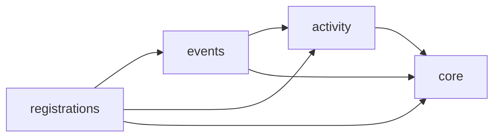
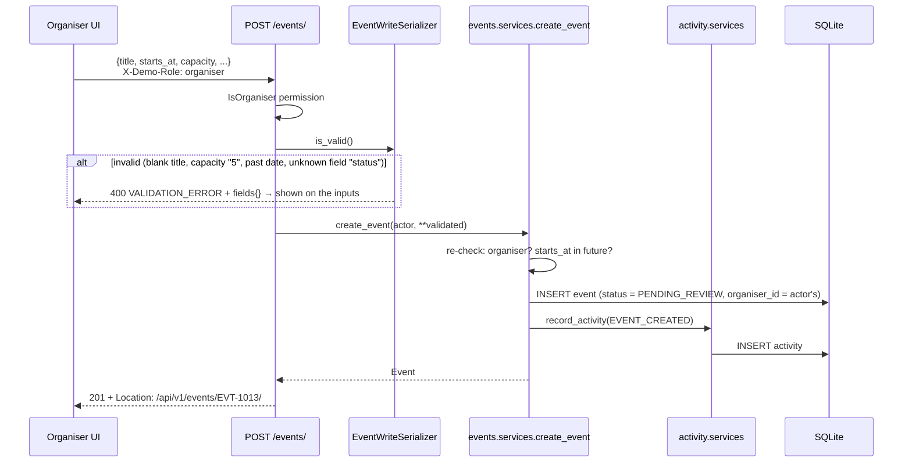
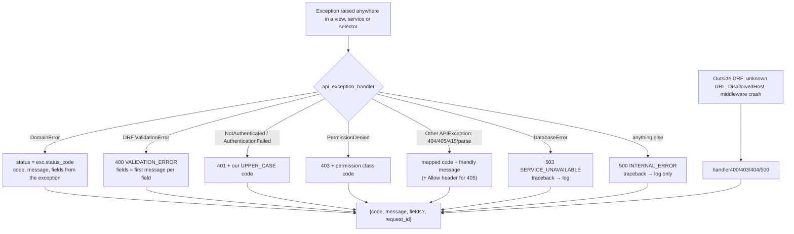

# Architecture guide

This document explains how Gather works and why it's built this way. You should be able to understand the whole system from it before opening the code. Paths are relative to the repository root.

**Contents**

1. [The big picture](#1-the-big-picture)
2. [The life of a request](#2-the-life-of-a-request)
3. [Backend apps and their public surface](#3-backend-apps-and-their-public-surface)
4. [Demo roles: authentication and permissions](#4-demo-roles-authentication-and-permissions)
5. [Error handling](#5-error-handling)
6. [Logging and request IDs](#6-logging-and-request-ids)
7. [Concurrency: the last spot](#7-concurrency-the-last-spot)
8. [Data model decisions](#8-data-model-decisions)
9. [Frontend architecture](#9-frontend-architecture)
10. [Security and privacy posture](#10-security-and-privacy-posture)
11. [Architecture decision records](#11-architecture-decision-records)
12. [How to extend it](#12-how-to-extend-it)
13. [Glossary](#13-glossary)

---

## 1. The big picture

Gather has three parts:

| Part | Technology | Responsibility |
| --- | --- | --- |
| Single-page app | React 19, TypeScript, Vite | Everything the user sees. Holds no business rules beyond friendly pre-validation |
| API service | Django 5.2 + DRF | **The source of truth** for every rule: who can do what, validation, capacity, status changes |
| Database | SQLite (one file) | Events, registrations, activity |

The backend is a **modular monolith**: one deployable Django project whose code is split into domain apps (`events`, `registrations`, `activity`) plus a shared kernel (`core`). Each app owns its models and logic. Apps depend on each other in one direction only:



`activity` doesn't import `registrations` (it stores a registration reference as plain text), so it could be lifted out into its own service without untangling a cycle. See [§12](#12-how-to-extend-it).

Inside each app the code is layered, and each layer only calls the one below it:

```
views.py        HTTP: parse + validate input, call ONE service/selector, serialize output
   │
services.py     writes and business rules (transactions, locks, status changes, activity)
selectors.py    reads and visibility rules (who can see what), derived counts
   │
domain.py       pure rules with no I/O (the status state machine, date/capacity rules)
models.py       tables, constraints, indexes
```

---

## 2. The life of a request

The full path of a request, using **register interest** as the example:

```mermaid
sequenceDiagram
    autonumber
    participant U as User
    participant R as React component
    participant Q as TanStack Query
    participant C as API client
    participant V as Vite proxy
    participant M as Middleware
    participant D as DRF view
    participant S as Service
    participant DB as SQLite

    U->>R: clicks "Register interest"
    R->>Q: mutation.mutate()
    Q->>C: api.register("EVT-1002")
    C->>V: POST /api/v1/events/EVT-1002/registrations/<br/>X-Demo-Role, X-Request-ID
    V->>M: forwards to :8000
    M->>M: accept/generate request id → contextvar
    M->>D: get_response()
    D->>D: DemoRoleAuthentication → Principal<br/>permission classes
    D->>S: register_interest(event_id=2, actor)
    S->>DB: BEGIN IMMEDIATE; SELECT event; COUNT(registrations)
    S->>DB: INSERT registration; INSERT activity; COMMIT
    S-->>D: Registration
    D-->>M: 201 + JSON receipt
    M-->>C: + X-Request-ID header
    C-->>Q: RegistrationResult
    Q->>Q: patch cached event counts,<br/>invalidate lists/stats/activity
    Q-->>R: success → confirmation UI
```

The steps that matter:

1. **The API client** (`frontend/src/lib/api/client.ts`) adds the role headers and a fresh `X-Request-ID`, and converts any failure (HTTP error, network down, proxy 502) into one `ApiError` type.
2. **`RequestIdMiddleware`** (`backend/apps/core/middleware.py`) stores the request ID in a `ContextVar`. Every log line written while handling this request, from any module, carries it.
3. **DRF authentication** turns the headers into a `Principal` (`request.user`). **Permission classes** reject the request early if the role can't call this endpoint.
4. **The view** validates input with a serializer, then calls **one** service or selector. No rules live in the view.
5. **The service** enforces the business rules inside a transaction, writes the activity entry in the same transaction, and logs each step.
6. On any exception, **DRF's exception handler** (`apps/core/handlers.py`) produces the single JSON error shape.
7. **TanStack Query** updates the cache. For registration, the response includes the fresh counts, so the page updates immediately, while lists refetch in the background.

### 2.1 Create an event



The status is always `PENDING_REVIEW` and the organiser is always the caller. Neither can be supplied by the client, because the strict serializer rejects them as "This field can't be set."

### 2.2 Publish an event

```mermaid
sequenceDiagram
    participant A as Admin UI
    participant Q as Query cache
    participant API as POST /admin/events/{id}/publish/
    participant Svc as events.services.publish_event
    participant SM as domain.ensure_transition
    participant DB as SQLite

    A->>Q: onMutate: mark row PUBLISHED (optimistic), row animates out of queue
    A->>API: publish
    API->>API: IsAdministrator permission
    API->>Svc: publish_event(event_id, actor)
    Svc->>DB: BEGIN IMMEDIATE; SELECT event FOR UPDATE
    Svc->>SM: PENDING_REVIEW → PUBLISHED allowed?
    alt already published / changes requested
        SM-->>A: 409 INVALID_STATUS_TRANSITION → rollback optimistic change + toast
    end
    Svc->>Svc: event started already? → 409 EVENT_ALREADY_STARTED
    Svc->>DB: UPDATE status, published_at; INSERT activity(EVENT_PUBLISHED); COMMIT
    API-->>A: 200 event → toast "… is live" with link
    A->>Q: invalidate events, stats, activity
```

### 2.3 Register: success, full, and the race

```mermaid
sequenceDiagram
    participant V1 as Visitor 1
    participant V2 as Visitor 2
    participant Svc as register_interest
    participant DB as SQLite (1 spot left)

    par both click at the same moment
        V1->>Svc: register
        V2->>Svc: register
    end
    Svc->>DB: V1: BEGIN IMMEDIATE (gets the write lock)
    Svc->>DB: V2: BEGIN IMMEDIATE (waits for the lock, up to 20 s)
    Svc->>DB: V1: status PUBLISHED ✓, not started ✓, 19 < 20 ✓
    Svc->>DB: V1: INSERT registration + activity; COMMIT (lock released)
    Svc-->>V1: 201 {id: REG-…, spots_remaining: 0}
    Svc->>DB: V2: (now holds the lock) count = 20, 20 ≥ 20
    Svc-->>V2: 409 EVENT_FULL (rollback, nothing written)
```

The order of checks in `register_interest` is: **exists** (404) → **published** (409 `EVENT_NOT_PUBLISHED`) → **not started** (409 `REGISTRATION_CLOSED`) → **has room** (409 `EVENT_FULL`) → insert. Why the lock matters is explained in [§7](#7-concurrency-the-last-spot).

---

## 3. Backend apps and their public surface

### `apps/core`: the shared kernel

Nothing domain-specific lives here, only what every app needs.

| Module | Public surface | Purpose |
| --- | --- | --- |
| `middleware.py` | `RequestIdMiddleware`, `SecurityHeadersMiddleware` | Request IDs, request received/completed logs, CSP |
| `request_context.py` | `get_request_id()` | ContextVar holding the current request ID |
| `logging.py` | `RequestIdFilter`, `SafeFormatter`, `kv()` | Tag log records, escape newlines, render `key=value` fields |
| `exceptions.py` | `DomainError`, `ValidationFailed`, `AdminOnly`, `OrganiserOnly`, `ServiceUnavailable` | Base error type with `code`, `message`, `status_code`, `fields` |
| `handlers.py` | `api_exception_handler`, `json_not_found`, … | The single error shape |
| `auth.py` | `Principal`, `Role`, `DemoRoleAuthentication` | Demo roles as a DRF authentication class |
| `permissions.py` | `IsAdministrator`, `IsOrganiser`, `IsEventOwner` | Access rules as DRF permission classes |
| `serializers.py` | `StrictInputSerializer`, `WholeNumberField`, `parse_query`, `ErrorResponseSerializer` | Reusable validation building blocks |
| `clock.py` | `now()` | One seam for "now", so tests can pin time |
| `pagination.py` | `StandardPagination` | `{count, page, page_size, total_pages, results}` |
| `views.py` | `HealthView`, `OrganiserDirectoryView` | `/health/` (with a DB round-trip), `/organisers/` |

### `apps/events`

| Module | Public surface |
| --- | --- |
| `models.py` | `Event`, `EventStatus`, `EventCategory`, `format_reference()` |
| `domain.py` | `ALLOWED_TRANSITIONS`, `ensure_transition()`, `starts_at_error()`, `capacity_error()` |
| `selectors.py` | `list_public_events`, `list_organiser_events`, `list_admin_events`, `get_event_for_actor`, `resolve_event_id`, `organiser_stats`, `admin_stats` |
| `services.py` | `create_event`, `update_event`, `publish_event`, `reject_event` |
| `exceptions.py` | `EventNotFound`, `NotEventOwner`, `InvalidStatusTransition`, `EventAlreadyStarted` |
| `management/commands/seed_demo_data.py` | Idempotent seed, `--reset` |

### `apps/registrations`

`models.Registration`; `services.register_interest`; `exceptions.EventNotPublished`, `RegistrationClosed`, `EventFull`.

### `apps/activity`

`models.Activity`, `ActivityKind`; `services.record_activity`; `selectors.list_activity`.

### Why separate services and selectors?

This follows the [HackSoft Django Styleguide](https://github.com/HackSoftware/Django-Styleguide).

- **Business rules have one home.** "Capacity can't drop below registrations" exists in exactly one place (`domain.capacity_error`, enforced by `services.update_event`), not partly in a serializer `validate()`, partly in a model `save()` and partly in a view.
- **Reads and writes have different concerns.** Selectors care about visibility and annotations (`registered_count`); services care about transactions, locks and side effects (activity entries).
- **Plain functions are easy to test and reuse.** The seed command calls the same services the API does, so seeded data obeys every rule, and the tests call services directly without HTTP.
- **Views stay boring.** Every view reads the same way: validate → call → serialize. A reviewer can check the HTTP contract and the business rules separately.
- **Keyword-only arguments** (`publish_event(*, event_id, actor)`) make call sites self-describing and stop argument-order mistakes.

Model methods (fat models) or DRF `ModelViewSet` overrides (`perform_create`) were the alternatives. Both tend to spread one rule across several hooks.

---

## 4. Demo roles: authentication and permissions

The brief needs three demonstration roles but no real authentication. Rather than scattering `if role == "admin"` checks around, the role is modelled the way real auth would be:

```python
# apps/core/auth.py
class DemoRoleAuthentication(BaseAuthentication):
    def authenticate(self, request):
        # X-Demo-Role: visitor | organiser | admin (default visitor)
        # X-Demo-Organiser-Id: organiser-1 (required for organiser, must be a seeded id)
        return (Principal(role=..., organiser_id=...), None)
```

- `request.user` is a frozen `Principal` dataclass with `is_admin`, `is_organiser` and `label`.
- Endpoints declare access with **permission classes**: `permission_classes = [IsAdministrator]`, or `[IsOrganiser(), IsEventOwner()]` for `PATCH /events/{id}/`. DRF raises `PermissionDenied` with the class's `message` and `code` (`ADMIN_ONLY`, `NOT_EVENT_OWNER`, …), which the handler passes straight through.
- **Services re-check** the role and ownership (`AdminOnly`, `NotEventOwner`). They don't trust their caller, which covers the seed command and future callers such as a management command or a queue consumer.
- An unknown role or organiser returns **401** (`INVALID_DEMO_ROLE` / `UNKNOWN_ORGANISER`).

**Caveat:** headers can be set by anyone. The design is "real auth-shaped", so replacing `DemoRoleAuthentication` with session or JWT authentication that yields a `Principal` would leave every permission class, service and test unchanged.

**Visibility vs. permission.** An organiser asking for *another* organiser's **pending** event gets **404**, because it isn't visible to them (that's a selector rule). If it's **published**, they can see it, and a `PATCH` gets **403** `NOT_EVENT_OWNER` (a permission rule). Visitors can't tell an unpublished event apart from one that doesn't exist.

---

## 5. Error handling

### The pipeline



`set_rollback()` is called first, so no half-finished transaction can commit. The frontend's `ApiError` class mirrors the body, and `lib/errors.ts` maps each `code` to a title and message. Transient errors (network, 5xx) are retried by TanStack Query and get a **Try again** button. Rule violations are never retried.

### Catalogue

| Code | HTTP | Raised by | What the UI shows |
| --- | --- | --- | --- |
| `VALIDATION_ERROR` | 400 | Serializers, `ValidationFailed` in services | "Check the highlighted fields". Each message is shown under its input |
| `MALFORMED_REQUEST` | 400 | Invalid JSON | Generic error |
| `BAD_REQUEST` | 400 | Django (e.g. disallowed host) | Generic error |
| `INVALID_DEMO_ROLE` | 401 | Unknown `X-Demo-Role` | Generic error |
| `UNKNOWN_ORGANISER` | 401 | Organiser ID isn't a seeded one | "Pick an organiser" |
| `ADMIN_ONLY` | 403 | `IsAdministrator`, `AdminOnly` | "Admins only. Switch to the Admin view" |
| `ORGANISER_ONLY` | 403 | `IsOrganiser`, `OrganiserOnly` | "Organisers only" |
| `NOT_EVENT_OWNER` | 403 | `IsEventOwner`, `NotEventOwner` | "Not your event" |
| `EVENT_NOT_FOUND` | 404 | Selectors (missing *or* not visible) | "We couldn't find that event" with a link back |
| `NOT_FOUND` | 404 | Unknown URL | 404 page |
| `METHOD_NOT_ALLOWED` | 405 | e.g. `PUT /events/{id}/`, `GET …/registrations/` | n/a |
| `UNSUPPORTED_MEDIA_TYPE` | 415 | Non-JSON body | n/a |
| `EVENT_NOT_PUBLISHED` | 409 | `register_interest` | "Not open yet" |
| `REGISTRATION_CLOSED` | 409 | `register_interest` (started) | "Registration has closed" |
| `EVENT_FULL` | 409 | `register_interest` | "This event is full". Counts refresh |
| `INVALID_STATUS_TRANSITION` | 409 | `domain.ensure_transition` | Toast "Already handled". Optimistic update rolled back |
| `EVENT_ALREADY_STARTED` | 409 | `publish_event` | Toast "Too late to publish" |
| `INTERNAL_ERROR` | 500 | Unhandled exception | "Something went wrong", with the request ID as a reference |
| `SERVICE_UNAVAILABLE` | 503 | `DatabaseError`, failed health check | "We're having trouble connecting" + Try again |
| `NETWORK_ERROR` | (none) | *Frontend only*: `fetch` failed | "You're offline" + Try again |
| `SERVICE_UNAVAILABLE` | 502/503/504 | *Frontend only*: proxy says Django is down | "We're having trouble connecting" + Try again |

**Why 409 for registration rejections?** The request is well-formed, but it conflicts with the current state of the resource (unpublished, full, started). 400 would suggest the client sent something malformed.

---

## 6. Logging and request IDs

**Design**

1. `RequestIdMiddleware` takes the caller's `X-Request-ID` **only if** it matches `^[A-Za-z0-9._-]{8,64}$`; otherwise it generates one. It sets a `ContextVar`, echoes the ID in the response header, and resets the ContextVar afterwards.
2. `RequestIdFilter` (attached to the console handler) copies the ContextVar onto every `LogRecord`, so code anywhere can call `logger.info(...)` without passing the ID around.
3. `SafeFormatter` escapes `\r` and `\n` in messages, so one log call can only ever produce one line, which prevents log injection.
4. Services log at their **boundaries** using `kv()` for consistent `key=value` fields. Only IDs and outcomes are logged: never titles, descriptions, notes, bodies, query strings, IPs or user agents.
5. Rejections are logged at `WARNING` with `code=`; unexpected errors at `ERROR` with the traceback.

**Annotated excerpt** (one registration, from the demo in the README):

```text
… INFO    [demo-register-0001] apps.request: request received method=POST path=/api/v1/events/EVT-1002/registrations/
          └─ request id from the caller ─┘   └─ middleware: the request arrived (no IP, no query string, no body)
… INFO    [demo-register-0001] apps.registrations.services: registration requested op=register_interest event=EVT-1002
                                                            └─ service boundary: operation name + event id
… INFO    [demo-register-0001] apps.registrations.services: event validated op=register_interest event=EVT-1002 status=PUBLISHED spots_before=2
                                                            └─ all four rules passed while holding the lock
… INFO    [demo-register-0001] apps.registrations.services: registration stored … registration=REG-WRPH0N1RHA
… INFO    [demo-register-0001] apps.activity.services: activity recorded kind=REGISTRATION_CREATED event=EVT-1002 registration=REG-WRPH0N1RHA activity_id=111
                                                            └─ same transaction as the registration
… INFO    [demo-register-0001] apps.registrations.services: registration completed … outcome=success
                                                            └─ logged after COMMIT, so "success" really means stored
… INFO    [demo-register-0001] apps.request: request completed method=POST path=… status=201 duration_ms=26.6
```

The frontend sends a UUID request ID with every call and shows it as **Reference** on error screens, so a user-reported problem maps directly to these lines. Django's own `django.server` and `django.request` loggers are raised to `WARNING`/`ERROR` to avoid duplicating the middleware's lines.

---

## 7. Concurrency: the last spot

**The problem.** "Count the registrations, and if there's room, insert one" is a *check-then-act* sequence. If two requests both run the *check* before either runs the *act*, both see "1 spot left" and both insert, and the event is overbooked.

**The fix, in plain English.** Make the check and the act happen as one indivisible step, so a second request has to wait until the first one has finished and then sees the updated count.

**How it's done**

```python
with transaction.atomic():                                   # one transaction for check + insert
    event = Event.objects.select_for_update().filter(pk=event_id).first()
    ...checks...
    if event.registrations.count() >= event.capacity: raise EventFull()
    Registration.objects.create(event=event)
    record_activity(...)
```

- On **SQLite**, `select_for_update()` does nothing (SQLite has no row locks). The real protection is `DATABASES["default"]["OPTIONS"]["transaction_mode"] = "IMMEDIATE"` (Django ≥ 5.1). Every transaction starts with `BEGIN IMMEDIATE`, which takes SQLite's database-wide **write lock** up front. A second writer waits (up to `timeout = 20` seconds) until the first commits, then reads the fresh count.
- On **PostgreSQL**, the same code issues `SELECT … FOR UPDATE`, which locks just that event's row. Other events stay fully concurrent. Keeping `select_for_update()` means the code is correct on both, and the comment says so honestly.
- **Why not SQLite's default `DEFERRED` mode?** Both transactions start by reading (taking shared locks), then both try to upgrade to a write lock, and SQLite resolves that deadlock by failing one with `database is locked`. That's a 500 error rather than a clean "full". The concurrency test demonstrates this: switch the mode to `DEFERRED` and it fails.
- **Why not a stored `registered_count` column with `F("count") + 1`?** It would need its own constraint to stop over-increment, and it can drift from the real rows. A derived count plus a lock is simpler and always correct.

**Test:** `apps/registrations/tests/test_concurrency.py` starts 8 threads behind a `threading.Barrier`, each with its own database connection to a **file-based** SQLite test database (in-memory shared-cache SQLite uses different locking, so it wouldn't prove anything). It asserts exactly one `ok`, seven `full`, and three registrations stored against a capacity of 3.

**Trade-off:** `BEGIN IMMEDIATE` serialises *all* writes across the whole database. That's fine for a demo; a production deployment would use PostgreSQL's row locks.

---

## 8. Data model decisions

See the ER diagram in the [README](../README.md#4-data-model-and-persistence).

| Decision | Why |
| --- | --- |
| **`EVT-1001` is derived from the integer PK** (`reference` property + `reference_to_pk`) and not stored | It can never disagree with the row, needs no extra unique index or second write on insert, and still reads well in logs, URLs and the UI. Malformed references simply give 404 |
| **Registration's PK *is* its reference** (`REG-` + 10 Crockford base32 characters, 50 random bits) | The brief allows exactly "a generated registration ID, event ID and timestamp", so there's no separate integer ID. Random rather than sequential, so it leaks no volume information. Crockford's alphabet avoids I/L/O/U, so it's easy to read aloud |
| **No personal-data columns, enforced by a test** | `test_registration_table_holds_no_personal_data` asserts the concrete field set is exactly `{reference, event, created_at}` |
| **`registered_count` is annotated, not stored** | `Count("registrations")` in the selectors. It can't drift; `spots_remaining` and `is_full` are computed in the serializer |
| **`CHECK` constraints** for capacity 1–10,000, valid status, valid category and non-empty title | The database is the last line of defence, even for code that bypasses services (shell, migrations, bugs) |
| **Indexes** `(status, starts_at)` and `(organiser_id, starts_at)` | These match the two hot queries: the visitor list (`WHERE status='PUBLISHED' ORDER BY starts_at`) and the organiser dashboard |
| **`on_delete=PROTECT`** for registration → event | Deleting an event with registrations should be a deliberate decision, not a silent cascade. Activity cascades, since it only describes the event |
| **Activity stores `actor` as a role label** (`admin`, `organiser-1`, `visitor`) | It's useful for auditing and is never a person |
| **Times stored in UTC** (`USE_TZ=True`) | Shown in the viewer's local zone by the frontend, which labels the zone |
| **`created_at` uses `default=clock.now`** | It's settable in tests, unlike `auto_now_add` |

---

## 9. Frontend architecture

### Structure

```
src/
  main.tsx                 providers: QueryClient → Theme → Viewer → MotionConfig → Tooltip → Router
  app/router.tsx           routes; every page is lazy-loaded (its own JS chunk)
  app/Layout.tsx           header (nav per role, theme, Viewing as), skip link, offline banner, toasts
  lib/api/                 client.ts (fetch wrapper + ApiError), endpoints.ts (typed calls + query keys), types.ts
  lib/errors.ts            code → friendly copy
  lib/format.ts            dates in the viewer's zone, relative time, datetime-local ↔ ISO
  components/ui/           design-system components (see the inventory below)
  features/
    role/                  viewer state, RoleSwitcher, RoleIntro, RoleGate, useSwitchViewer
    theme/                 light/dark/system
    events/                DiscoverPage, EventDetailPage, EventCard, capacity helpers, queries
    registrations/         RegisterPanel (button → celebratory receipt)
    organiser/             OrganiserDashboard, EventEditorPage (form + live preview), queries
    admin/                 ReviewQueuePage, ActivityPage, publish/request-changes actions, queries
  styles/tokens.css        THE design tokens
```

### Routing

| Path | Page | Role |
| --- | --- | --- |
| `/` | Discover (filters are in the URL: `?category=arts&upcoming=0&q=yoga`) | everyone |
| `/events/:id` | Event detail; actions depend on role | everyone |
| `/organiser` | Your events | organiser |
| `/organiser/events/new`, `/organiser/events/:id/edit` | Editor | organiser |
| `/admin`, `/admin/activity` | Review queue, Activity | admin |

Role-specific pages are wrapped in `RoleGate`. The wrong role sees a friendly "This page is for organisers" panel with a one-click switch, never a dead end. The server enforces the same rules regardless.

### State management

- **Server state lives in TanStack Query, and nowhere else.** Query keys include *who's asking* when the answer depends on it (`["events","detail",id,viewerKey]`), so an organiser's view of a pending event never leaks into the visitor cache.
- **Mutations:**
  - **Register:** update the cached counts from the response, then invalidate lists.
  - **Publish / request changes:** optimistic. The status flips immediately, rolls back on error with a toast, and is reconciled on settle.
  - **Save event:** server field errors are mapped onto the form inputs.
- **Retries:** only for transient errors (`status 0` or `≥ 500`). A 404 or 409 won't fix itself.
- **Client state** is tiny: the viewer (role and organiser ID), theme, and whether the intro has been seen, all in `localStorage` with safe fallbacks if storage is unavailable. The viewer is pushed **synchronously** into the API client when it changes, so the next request carries the new headers.

### The API client

```ts
apiRequest<T>(path, { method, body, signal }) → Promise<T>  // throws ApiError
```

It adds `X-Demo-Role`, `X-Demo-Organiser-Id` and `X-Request-ID`. It recognises our error shape, maps proxy 502/503/504 responses (Django not running) to `SERVICE_UNAVAILABLE`, and maps network failures to `NETWORK_ERROR`. Components only ever see `ApiError`.

### Design system

- **Tokens** (`styles/tokens.css`): colour (canvas, surface, border, three text levels, one indigo accent, success/warning/danger and their soft tints), radius (6/8/12/16px), shadow (xs/card/lift/pop) and motion (150/200ms, ease-out). Light and dark redefine the same CSS variables; Tailwind's `@theme inline` exposes them as utilities (`bg-surface`, `text-fg-muted`). Components never use raw colours. Contrast was computed for every text/background pair, and all meet WCAG AA (the ratios are recorded in the file).
- **Type:** Geist (UI) and Geist Mono (references like `EVT-1002`), self-hosted.
- **Theme:** an inline script in `index.html` applies the saved or system theme before first paint, so there's no flash. The menu offers Light, Dark and System.

**Component inventory** (`components/ui` and shared feature components)

| Component | Notes |
| --- | --- |
| `Button` | primary / secondary / ghost / danger / success; 44px tap height on touch; `loading` spinner + `aria-busy`; `asChild` for links |
| `Badge`, `StatusBadge` | Status badges can explain themselves in a tooltip ("Pending review: an admin will review…") |
| `Field`, `Input`, `Textarea`, `CharCount`, `Select` | Label/hint/error wired with `aria-describedby`, `aria-invalid`; Radix Select |
| `Dialog`, `ConfirmDialog` | Radix (focus trap, Escape, scroll lock); `returnFocusTo` for when the trigger disappears |
| `Toaster` + `toast()` | Radix Toast (an `aria-live` region); success/info/error; optional link action |
| `Tooltip` | Radix |
| `Skeleton`, `LoadingRegion` | Skeletons mirror the final layout; one `role=status` announcement |
| `EmptyState`, `ErrorState`, `Callout` | Every empty state offers a next step; every error offers a retry and shows the request ID |
| `PageHeader`, `StatTile` | |
| `EventCard`, `DateBlock`, `CapacityMeter` | `role="meter"` with a spoken `aria-valuetext` ("18 of 20 spots taken. Only 2 spots left.") |
| `RoleSwitcher`, `RoleIntro`, `RoleGate` | |

### Imagery and motion

**Photography.** Each event has a cover photo chosen from 15 bundled Unsplash images (`src/features/events/covers.ts`). The API stores only a key (`"sourdough"`), checked against `CoverImage` choices and a DB `CHECK` constraint, so no URL or file path can ever be injected. `coverFor(event)` falls back to the category's default. Images are WebP at 800px and 1600px, served with `srcset`/`sizes`, lazy-loaded below the fold and eager with `fetchpriority=high` for heroes. While loading, a placeholder in the photo's average colour shows, then the image fades in from a slight blur (`CoverImage`).

**Motion inventory** (all in `src/components/motion/primitives.tsx` or next to the feature that uses it):

| Effect | Where | How |
| --- | --- | --- |
| Ken Burns crossfade slideshow + cursor parallax | Discover hero | `AnimatePresence` crossfade, a slow `scale` per slide, a spring-smoothed pointer offset |
| Word-by-word headline, count-up stats | Hero, event page, ticket | `StaggerWords` (masked rise), `CountUp` (animates once in view) |
| Infinite "Coming up" marquee | Discover | CSS keyframes over a duplicated list; pauses on hover/focus |
| Sliding category pill | Discover filters | Shared `layoutId` between chips |
| Staggered reveal + layout reflow | Event grid | `whileInView`, `layout`, `AnimatePresence mode="popLayout"` on filter changes |
| 3D tilt with cursor-following glare | Event cards | `TiltCard`: springs on rotateX/Y plus a radial-gradient glare; mouse/trackpad only |
| Card → page photo morph | Card → event page (and back) | View Transitions API via `<Link viewTransition>`; card photo and hero share a `view-transition-name` |
| Scroll parallax | Event hero, "host an event" band | `useScroll` + `useTransform` |
| Scroll-linked progress line | "How it works" | `scrollYProgress` → `scaleX` |
| Ticket + confetti | Registration success | Spring-in ticket; 42 particles arcing up and falling |
| Capacity bar fill, page fade-in | Everywhere | `scaleX` on view; a 350ms fade on route change |

**Reduced motion.** `<MotionConfig reducedMotion="user">` disables transform animations globally. Effects that aren't plain transforms check `useReducedMotion()` themselves (slideshow, parallax, tilt, confetti, count-up), and CSS animations and view transitions are switched off in a `prefers-reduced-motion` media query. The result is a fully static, still-polished page.

### Accessibility decisions

- Semantic landmarks (`header`, `nav`, `main`, `footer`, `aside`), one `h1` per page, a skip link, and focus moved sensibly after actions (the queue heading after publishing, the first invalid field after a failed submit).
- Visible `:focus-visible` rings everywhere. Whole-card click targets use a stretched link, so each card is announced as one link.
- `aria-live` for toasts, the registration result and filter result counts.
- Radix handles keyboard support for menus, selects, dialogs, toggle groups and switches.
- `prefers-reduced-motion`: CSS animations are disabled globally, and `<MotionConfig reducedMotion="user">` turns off transform animations in `motion`.
- Tap targets are at least 44px on touch layouts. Layouts were checked at 360px, 375px and desktop widths with no horizontal scroll.

---

## 10. Security and privacy posture

| Protected | How |
| --- | --- |
| No personal data stored | Registration has 3 columns, test-enforced; no accounts |
| No personal data logged | Logs carry IDs and outcomes only; no IP, user agent, body or query string. Test-enforced for IP and user agent |
| No leaked internals | Single exception handler; generic 500; Django error pages replaced with JSON |
| No HTML injection | React escaping; `white-space: pre-line` instead of HTML for line breaks; ESLint ban on `dangerouslySetInnerHTML`; JSON-only API with CSP `default-src 'none'` and `nosniff` |
| No log injection | Newlines escaped; caller request IDs restricted to a safe character set |
| Input validation | Strict serializers (unknown fields rejected, JSON integers only for capacity, length limits), service-level rule checks, DB `CHECK` constraints |
| Clickjacking | `X-Frame-Options: DENY`, `frame-ancestors 'none'` |
| Secrets | None committed; `.env` gitignored; random `SECRET_KEY` fallback; `DEBUG` off by default |
| Third-party requests | None from the frontend (fonts self-hosted) |

| **Not** protected (by design, for a demo) | Why / mitigation |
| --- | --- |
| Identity | Demo role headers are spoofable. Swap in real auth behind `Principal` |
| Rate limiting / abuse | Anyone can register repeatedly (the brief says duplicate prevention isn't required). Add DRF throttling |
| CSRF | No cookies or sessions, so not applicable. Re-enable `CsrfViewMiddleware` if session auth is added |
| HTTPS, HSTS | Terminated by the hosting platform in production |
| Frontend CSP | The Vite dev server sets none (its HMR needs inline scripts). Set one at the static host in production |

---

## 11. Architecture decision records

### ADR-001: Django + DRF modular monolith
**Context.** The brief wants one Python service with clear APIs and a sensible domain model, finishable in a short time and explainable in an interview.
**Decision.** Use Django 5.2 LTS + DRF, split into `core`, `events`, `registrations` and `activity` apps, with one-directional dependencies.
**Consequences.** Migrations, constraints, an admin-free ORM and a mature validation/permission framework out of the box. The app boundaries are ready for a later split.
**Rejected.** FastAPI (more glue to write for migrations and validation errors); a second service now (the brief prefers a complete single service).

### ADR-002: Services and selectors instead of fat models or viewset hooks
**Context.** Rules like capacity, status transitions and ownership need one obvious home.
**Decision.** Plain functions with keyword-only arguments in `services.py` (writes) and `selectors.py` (reads); pure rules in `domain.py`; thin views.
**Consequences.** Rules are tested without HTTP, the seed command reuses them, and views are uniform. It's slightly more files than a `ModelViewSet`.
**Rejected.** `ModelViewSet` + `perform_create` (rules split across hooks); model `save()` overrides (implicit side effects).

### ADR-003: Demo roles as a DRF authentication class
**Context.** The brief needs roles but not real auth; server-side enforcement is a "positive addition".
**Decision.** `DemoRoleAuthentication` reads headers into a `Principal`; DRF permission classes guard endpoints, and services re-check.
**Consequences.** Real auth could replace one class. Headers are spoofable, which is documented.
**Rejected.** A frontend-only role toggle (no server enforcement); fake login and sessions (friction, plus CSRF concerns).

### ADR-004: One error shape via a custom exception handler
**Context.** The brief requires meaningful errors with no internals.
**Decision.** A `DomainError` hierarchy carrying `code`, `message`, `status_code` and `fields`, with `api_exception_handler` mapping everything (DRF, Django, DB, unknown) to `{code, message, fields?, request_id}`.
**Consequences.** The frontend handles a single type, codes are stable for UI copy, and the request ID ties errors to logs.
**Rejected.** DRF's default `{"detail": …}` (inconsistent shapes, not friendly); per-view try/except (repetitive).

### ADR-005: SQLite with `BEGIN IMMEDIATE` for race safety
**Context.** Capacity must not be exceeded under concurrent registration.
**Decision.** Check-then-insert inside `transaction.atomic()` with `select_for_update()`, and set SQLite to `transaction_mode=IMMEDIATE`.
**Consequences.** Correct on SQLite and PostgreSQL. SQLite serialises all writes (acceptable here). Proven by a threaded test.
**Rejected.** `DEFERRED` (lock-upgrade deadlocks → 500s); a stored counter (drift, extra constraint); app-level locks (don't work across processes).

### ADR-006: Derived references and counts
**Context.** IDs should be readable; counts must be accurate.
**Decision.** `EVT-{1000+pk}` is computed; registration references are random primary keys; counts are annotated.
**Consequences.** Nothing can drift. Event IDs are guessable, which is fine because visibility is enforced by selectors.
**Rejected.** UUIDs everywhere (unfriendly in logs and the UI); a stored `reference` column (a second write and a uniqueness concern).

### ADR-007: Strict input serializers
**Context.** DRF silently ignores unknown fields and coerces `"5"`, `5.0` and `true` to integers.
**Decision.** `StrictInputSerializer` rejects unknown and read-only fields; `WholeNumberField` accepts only JSON integers.
**Consequences.** `{"status": "PUBLISHED"}` gives a clear 400 rather than a misleading 200, and the capacity rule means exactly what it says. Clients must send exact types.
**Rejected.** DRF defaults (surprising coercion).

### ADR-008: Vite proxy instead of CORS
**Context.** The SPA and API run on different ports in development.
**Decision.** Vite proxies `/api` to Django.
**Consequences.** No `django-cors-headers` and same-origin semantics. In production, the static host would proxy similarly.
**Rejected.** CORS (an extra dependency and configuration).

### ADR-009: TanStack Query for server state; no global store
**Context.** Most UI state is server data with loading, error and cache needs.
**Decision.** TanStack Query for all server data; React context only for the viewer and theme.
**Consequences.** Built-in retries, cache invalidation and optimistic updates. No Redux-style boilerplate.
**Rejected.** Redux/Zustand (duplicate cache logic); plain `useEffect` fetching (no caching, race-prone).

### ADR-010: Tailwind v4 + token CSS variables + Radix primitives
**Context.** It needs a distinct, consistent, accessible UI with dark mode, built quickly.
**Decision.** One `tokens.css` with CSS variables for both themes, exposed as Tailwind utilities; Radix for interactive primitives.
**Consequences.** Dark mode is automatic, and focus management and ARIA are handled by a well-tested library. Class conflicts are avoided by design (props such as `plain`), with no class-merging dependency.
**Rejected.** A component library such as MUI (generic look, heavy); hand-rolled dialogs and menus (accessibility risk).

### ADR-011: Native `datetime-local` for date and time
**Context.** It needs a date-time picker with time-zone clarity.
**Decision.** The native input, styled with the tokens, plus a hint showing the viewer's zone ("GMT+2, Africa/Johannesburg"). Values are converted to UTC ISO strings before sending.
**Consequences.** It's accessible and mobile-friendly by default, with no dependency. Its look varies a little by browser.
**Rejected.** A JS date-picker library (weight, plus accessibility work to verify).

### ADR-012: Self-hosted fonts
**Context.** It needs a modern typeface, and the platform's theme is privacy.
**Decision.** Use `@fontsource-variable/geist` instead of Google Fonts.
**Consequences.** No visitor IP is sent to third parties, and it works offline.

### ADR-013: Curated, bundled cover photos instead of uploads
**Context.** The UI needs real imagery, but file uploads are out of scope, and hot-linking a CDN would leak visitor IPs.
**Decision.** Bundle 15 free-licence Unsplash photos (two WebP widths each). Store a key per event, validated server-side, with the category's photo as the fallback.
**Consequences.** It looks like a real product, needs no storage or moderation, and makes no third-party requests. Organisers can't use their own photos, and the repo grows by about 5.5 MB.
**Rejected.** Uploads (out of scope, plus security and moderation work); hot-linking Unsplash (privacy); AI-generated images (inconsistent realism).

### ADR-014: View Transitions for card-to-page continuity
**Context.** It needs a "wow" transition from a card to its event page without a heavy animation framework for routing.
**Decision.** React Router's `<Link viewTransition>` with a shared `view-transition-name` on the card photo and the page hero.
**Consequences.** A native, GPU-composited morph in supporting browsers. Others simply navigate normally (progressive enhancement), and it's off under reduced motion.

---

## 12. How to extend it

### Add a `CANCELLED` status
1. `events/models.py`: add `CANCELLED` to `EventStatus` and run `makemigrations` (the status `CHECK` constraint is regenerated from `EventStatus.values`).
2. `events/domain.py`: add `PUBLISHED → CANCELLED` (and maybe `PENDING_REVIEW → CANCELLED`) to `ALLOWED_TRANSITIONS`, plus friendly messages.
3. `events/services.py`: add `cancel_event(*, event_id, actor)`, modelled on `publish_event`. Record an `EVENT_CANCELLED` activity kind (add it to `ActivityKind`).
4. `registrations/services.py`: cancelled events already fail the `status != PUBLISHED` check. Consider a dedicated `EVENT_CANCELLED` 409 code for clearer copy.
5. Add an endpoint (`POST /organiser/events/{id}/cancel/` or an admin equivalent) with a permission class.
6. Frontend: add the status to `types.ts`, `StatusBadge`, `KIND_META`, and a `ConfirmDialog` action.
7. Tests: the transition table, the service, the API, and that cancelled events are hidden.

### Split out a second service (brief §7.6)
The natural boundary is **activity/notifications**, which is already a leaf:
1. Move `apps/activity` into a new Django (or FastAPI) service with `POST /activity/` and `GET /activity/`.
2. In the main service, replace `record_activity()` with an HTTP client that forwards `X-Request-ID` (from `get_request_id()`) and uses a short timeout.
3. Decide on failure semantics: either fail the publish with **503** `ACTIVITY_UNAVAILABLE` (consistent but less available), or commit the change and write to an *outbox* table that a retry job drains (available, eventually consistent). The second is the more robust choice.
4. Point the admin feed at the new service, or proxy it.
5. Tests: a contract test for the client; a test that a dependency outage produces the documented error; request-ID propagation visible in both services' logs.

### Swap in real authentication
Implement an authentication class that resolves a session or token to a `Principal(role, organiser_id)`, and remove the demo headers from the frontend client. The permissions, services and tests stay the same.

### Move to PostgreSQL
Change `DATABASES` (e.g. via `dj-database-url`) and drop the SQLite-only `transaction_mode` option. `select_for_update()` then gives row-level locking automatically.

---

## 13. Glossary

| Term | Meaning |
| --- | --- |
| **Activity** | An append-only record of something that happened (published, registered…), shown to admins. The brief's "notification or activity record" |
| **Annotation** | A computed column added by the ORM (`Count("registrations")` → `registered_count`) |
| **Check-then-act** | Reading state, deciding, then writing. Unsafe under concurrency without a lock |
| **ContextVar** | Python's per-task/per-thread variable, used to carry the request ID to the logs |
| **DomainError** | Base exception for business-rule failures, carrying `code`, `message` and `status_code` |
| **Modular monolith** | One deployable service whose code is split into well-bounded modules (Django apps) |
| **Optimistic update** | Updating the UI before the server confirms, and rolling back on error |
| **Principal** | The acting identity: here a demo role, plus an organiser ID for organisers |
| **Request ID / correlation ID** | An identifier attached to one request and to every log line and error it produces |
| **Selector** | A read function that encapsulates queries and visibility rules |
| **Service** | A write function that encapsulates business rules, transactions and side effects |
| **State machine** | The allowed status transitions (`ALLOWED_TRANSITIONS`), defined in one place |
| **Token (design)** | A named design value (colour, radius, shadow) defined once in CSS variables |
